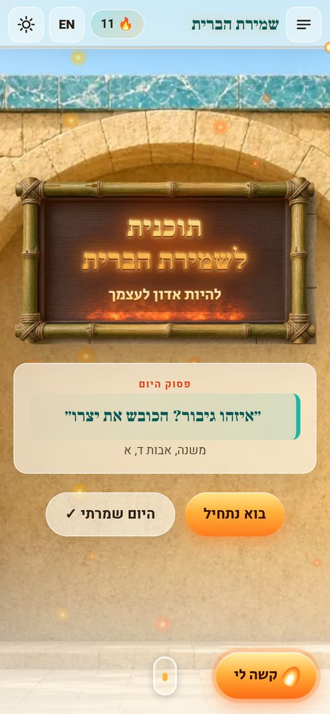
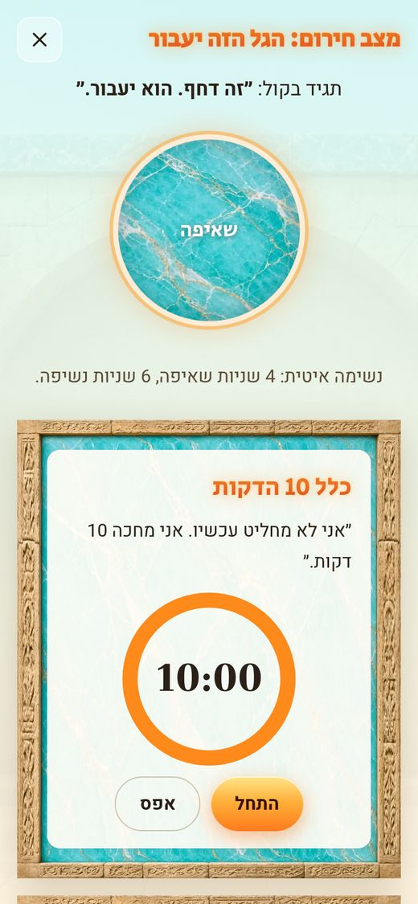
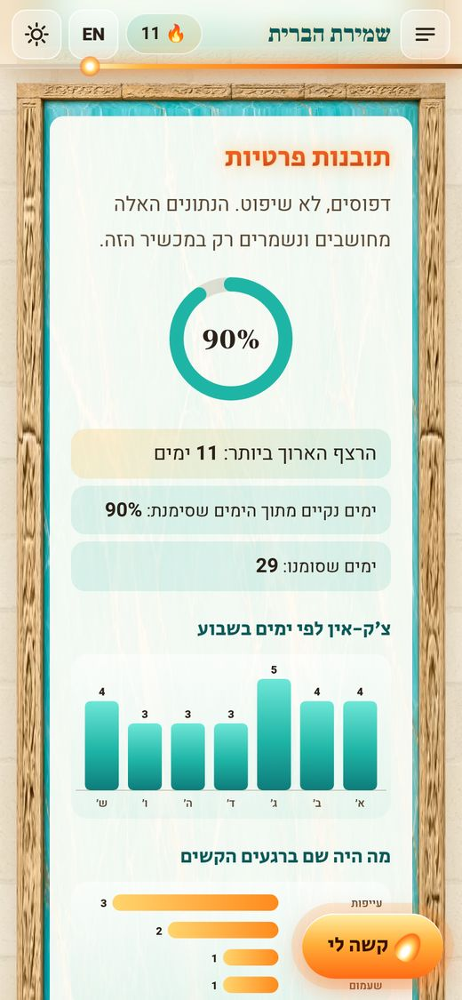
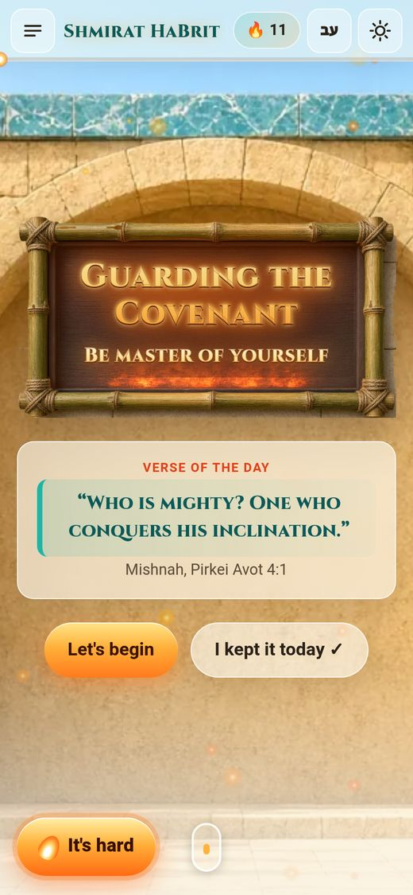
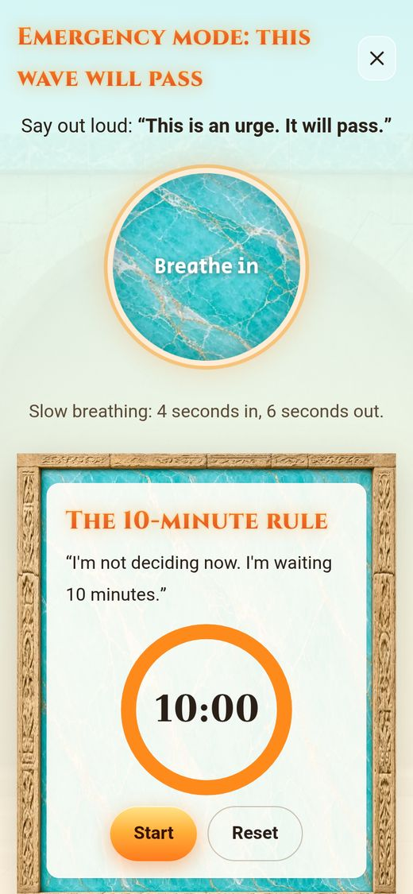
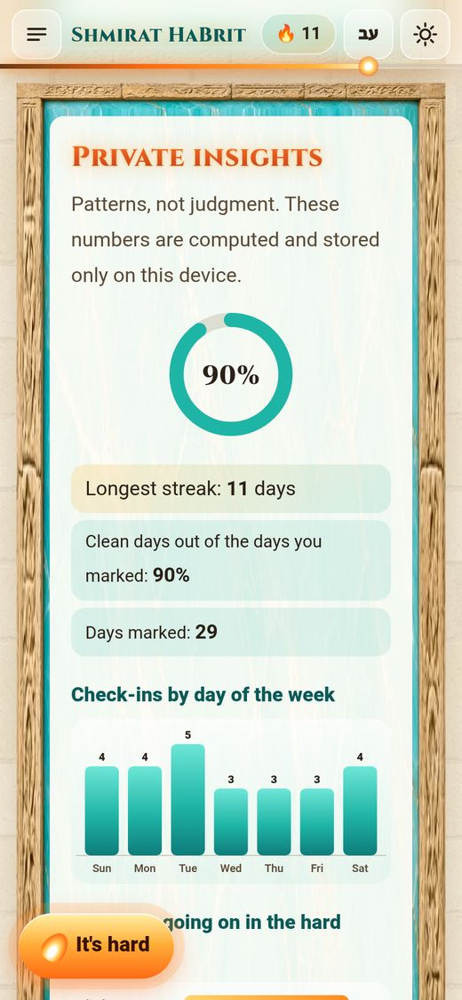

# שמירת הברית 🔥

**להיות אדון לעצמך.** תוכנית מעשית לשליטה עצמית ולהשתחררות מפורנו ומאוננות כפייתית, ואפליקציה פרטית שמלווה אותה יום אחרי יום.

**למי זה מתאים?** לגבר שרוצה לחזור לשלוט בעצמו, בלי אשמה ובלי סיסמאות, עם כלים פשוטים, מקורות מהתורה ושגרה שבונה כוח.

🔗 **לפתוח את האפליקציה:** https://salvinorin95.github.io/shmirat-habrit/
📖 **התוכנית המלאה:** [plan/README.md](plan/README.md) · [English](plan/README.en.md)

  
  
  

## מה יש באפליקציה
- 📜 **התוכנית המלאה** בעשרה פרקים, עם צ׳קליסטים שנשמרים אצלך.
- 🔥 **מעקב רצף:** צ׳ק-אין יומי, טבלת רצפים ואבני דרך.
- 🆘 **מצב חירום "קשה לי עכשיו":** נשימה מודרכת, טיימר 10 דקות וצעדים ברורים לעבור את הגל.
- 📊 **תובנות פרטיות:** הרצף הארוך ביותר, אחוז ימים נקיים, צ׳ק-אינים לפי ימי השבוע, טריגרים ושעות ביום. הכול מחושב על המכשיר.
- 🤝 **שותף אחריות:** שיתוף מספר הימים בלבד (שיתוף מהמכשיר, וואטסאפ, טלגרם או העתקה) ותזכורת שבועית לשלוח עדכון.
- 🌐 **עברית ו-English**, מצב בהיר/כהה, ועובדת גם בלי אינטרנט.
- 💾 **גיבוי:** ייצוא וייבוא של קובץ JSON, ומחיקת כל הנתונים בלחיצה.

## התקנה בטלפון
**אנדרואיד (Chrome):** לפתוח את הקישור ← תפריט ⋮ ← "התקנת אפליקציה" או "הוספה למסך הבית".

**אייפון (Safari):** לפתוח את הקישור ב-Safari ← כפתור השיתוף ← "הוסף למסך הבית".

אחרי ההתקנה האפליקציה נפתחת במסך מלא ועובדת גם אופליין.

## פרטיות
אין מעקב, אין אנליטיקס, אין שרת ואין חשבון. כל הנתונים (רצף, יומן, טריגרים, שם השותף) נשמרים **רק בדפדפן של המכשיר שלך**. בשיתוף נשלחים רק מספר הימים והקישור לאפליקציה.

## הבהרה
זו תוכנית לעזרה עצמית ולא ייעוץ רפואי או טיפולי. אם ההתנהגות מרגישה כפייתית, פוגעת בחיים, או שמצב הרוח שלך ירוד, פנה לאיש מקצוע (פסיכולוג, מטפל או רופא). במצב חירום רגשי בישראל: ער"ן 1201 או מד"א 101.

רישיון: [MIT](LICENSE)

---

# Shmirat HaBrit: Guarding the Covenant 🔥

**Be master of yourself.** A practical self-mastery plan for breaking free from porn and compulsive masturbation, with a private app that walks with you day by day.

**Who is it for?** Any man who wants to take back control of himself. No guilt and no slogans, just simple tools, Torah sources and a routine that builds strength.

🔗 **Open the app:** https://salvinorin95.github.io/shmirat-habrit/ (switch to English with the `EN` button in the top bar)
📖 **The full plan:** [plan/README.en.md](plan/README.en.md) · [עברית](plan/README.md)

  
  
  

## Features
- 📜 **The full plan** in ten chapters, with checklists saved on your device.
- 🔥 **Streak tracker:** daily check-in, streak table and milestones.
- 🆘 **"It's hard right now" emergency mode:** guided breathing, a 10-minute timer and clear steps to ride out the wave.
- 📊 **Private insights:** best streak, clean-days percentage, check-ins by weekday, triggers and time of day. All computed on your device.
- 🤝 **Accountability partner:** share only your day count (native share, WhatsApp, Telegram or copy) plus an optional weekly reminder to send an update.
- 🌐 **Hebrew and English**, light/dark mode, and it works offline.
- 💾 **Backup:** export and import a JSON file, or wipe everything in one tap.

## Install on your phone
**Android (Chrome):** open the link, then menu ⋮ → "Install app" or "Add to Home screen".

**iPhone (Safari):** open the link in Safari, tap the Share button → "Add to Home Screen".

Once installed it opens full screen and works without internet.

## Privacy
No tracking, no analytics, no server, no account. Everything (streak, log, triggers, partner name) is stored **only in your device's browser**. Sharing sends just your day count and the app link.

## Disclaimer
This is a self-help plan, not medical or therapeutic advice. If the behavior feels compulsive, is hurting your life, or your mood is low, please reach out to a professional (psychologist, therapist or doctor). In an emotional emergency: in Israel, ERAN 1201 or Magen David Adom 101; elsewhere, your local emergency number.

License: [MIT](LICENSE)
